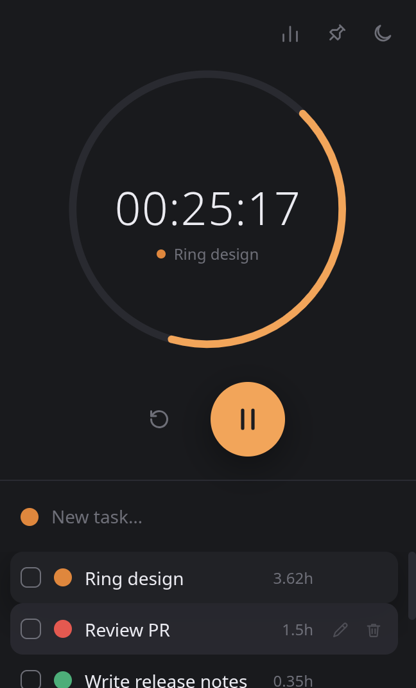
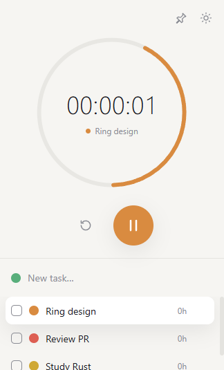

# Timer Focus

<p align="center">
  
  &nbsp;&nbsp;
  
</p>

A minimal count-up focus timer for the desktop, with a spinning eased ring,
light/dark theme, always-on-top and a tiny to-do list that tracks how many
hours went into each task.

> **Status:** a personal study project, built with Electron. Runs on Windows
> and Linux.

## Features

- **Count-up timer** — starts at `00:00:00` and shows hours, minutes and
  seconds. Play, pause and reset.
- **Eased ring** — the arc around the clock spins with an ease-in-out on every
  lap, glides to a stop when paused and rewinds when reset.
- **Light and dark theme** — follows the system by default; your choice is
  remembered.
- **Always on top** — pin the window above everything else with one click.
- **To-do with tracked time** — each task has a name and a color tag. While a
  task is selected, the time you count is added to it (`1.5h` = 1 hour 30
  minutes), and it keeps adding up every time you come back to it. Name and
  tracked hours can be edited at any time.

## Why Timer Focus

Most focus timers count down from a fixed block. Timer Focus counts up and
logs the time against whatever you're working on, so it answers *"how long did
this actually take?"* instead of *"is my 25 minutes over?"*:

- **No task required** — the timer works on its own; time only goes to a task
  when one is selected.
- **Safe task switching** — switching tasks while the timer runs asks for
  confirmation, saves the time to the previous task and restarts the clock.
- **Reset never loses work** — it only clears the display; time already counted
  stays on the task.
- **Local only** — everything is saved to a JSON file on your machine. No
  account, no cloud.

## Requirements

- Windows 10/11 or Linux (x64)
- To build from source: Node.js `20+`

## Installation

Download an installer from the latest build, or build it yourself:

```sh
npm install
npm run dist
```

The output goes to `release/`:

| Platform | Files |
| --- | --- |
| Windows | `Timer Focus Setup <version>.exe` (installer), `Timer Focus <version>.exe` (portable) |
| Linux | `.AppImage`, `.deb` |

The installers are not code-signed, so Windows SmartScreen shows a warning on
the first run.

## Usage

| Action | How |
| --- | --- |
| Start / pause | Big round button |
| Reset the display | Circular-arrow button (task time is kept) |
| Add a task | Type in **New task…** and press Enter; click the dot first to pick a color |
| Select a task | Click it; click again to go back to free mode |
| Edit a task (name, tracked hours) | Pencil icon on hover |
| Change a task's color | Click its color dot |
| Complete / remove | Checkbox / trash icon on hover |
| Today's report | Bar-chart icon, top right (click again to go back) |
| Always on top | Pin icon, top right |
| Switch theme | Sun/moon icon, top right |

Data lives in the app's user data folder (`%APPDATA%\timer-focus` on Windows,
`~/.config/timer-focus` on Linux).

## Development

```sh
npm run dev       # Vite + Electron with hot reload
npm start         # build the UI and run the app
npm run dev:web   # UI only, in the browser (saves to localStorage)
```

If `node_modules/electron/dist` is missing after install, run
`node node_modules/electron/install.js`.

Pushing a `v*` tag runs [`.github/workflows/build.yml`](.github/workflows/build.yml),
which builds the Windows and Linux installers and attaches them as workflow
artifacts.

### Project structure

- `electron/main.cjs` — window, always-on-top, native theme, single instance and
  JSON persistence
- `electron/preload.cjs` — the bridge exposed to the UI as `window.timerFocus`
- `src/stopwatch.ts` — timestamp-based stopwatch (no drift) and time formatting
- `src/ring.ts` — the ring animation: eased laps, braking and rewind
- `src/main.ts` — controls, tasks, theme and always-on-top wiring
- `src/report.ts` — today's time log and the report view
- `src/modal.ts` — confirmation and edit-task dialogs
